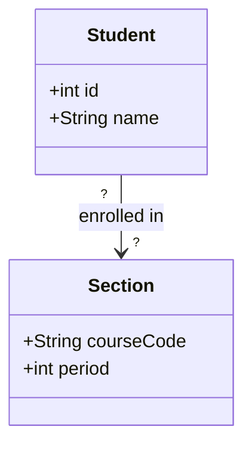

# Let's Design a Software Solution: The Scheduling Problem
by
# The Tallyers
## Saxon Rassner, Rona Wassercug, and Marcos Lehman
with assistance from
## Liberty (Saxon), Daffodil (Rona), and Psyduck (Marcos)

* * *

#### Step 0: As a trio...  
Review notes from 3rd-yr CS. What data structures and algorithms do you know? What do you recall about class diagrams? Inheritance? Etc...  

#### Step 1: Then proceed...  
> **USAGE:** **[SHAZAAM]** signals Devo input requested. Write response in space provided. _Extra-team "cross-polination" permitted._

---

## BACKGROUND

Stewie Vassant High School (~3,300 students) needs a "software solution" for their management problems. Specifically, with these **resource allotments**:

- **Students** (id, name, grade)
- **Teachers** (id, name, department)
- **Rooms** (room number, capacity, type: lab/gym/classroom)
- **Courses** (code, title, credits)
- **Sections**: one course, taught by one teacher, in one room, during one period; holds up to *capacity* students
- **Enrollments**: which students are in which sections

## CONSTRAINTS

1. No teacher in 2 sections same period
2. No room hosting 2 sections same period
3. No student in 2 sections same period
4. Enrollment cannot exceed room capacity
5. Physics labs must use a room of type `lab`
6. CS labs must use a room of type `cslab`
7. No CS lab may be booked through the SU's club reservation system.

## RULES

Use **only** what you know from APCS-AB|NeXTCS: classes, arrays, `ArrayList`, `HashMap` (dictionary), linked lists, stacks, queues, trees, sorting/searching, and execution time classification (Big-O).

**Hnady vars for runtime classifcations (Big-O):**  
S = students, T = teachers, R = rooms, N = sections, E = enrollments.

---

## Part 1: Design Your Data Structures

### 1.1 Class cards

UML refresher: think of each class as a Monopoly property card:

- **Top:** class name
- **Upper section:** instance variables (`- name : Type`)
- **Lower section:** methods (`+ name(params) : ReturnType`)

Example (partially complete):

```
+----------------------------------+
| Student                          |
+----------------------------------+
| - id : int                       |
| - name : String                  |
| - grade : int                    |
| - ???                            |
+----------------------------------+
| + getName() : String             |
| + ???                            |
+----------------------------------+
```

**[SHAZAAM]** Finish the Student card above (replace every `???`, add as many lines as you need). Then complete a card for each class below. Add your own cards for any extra classes you need.

**Card: Student** (finish the example above; copy your final version here)

```
+----------------------------------+
| Person                           |
+----------------------------------+
| - id : int                       |
| - name : String                  |
| - schedule : HashMap             |
|                                  |
|                                  |
+----------------------------------+
|                                  |
|                                  |
|                                  |
|                                  |
+----------------------------------+
```

```
+----------------------------------+
| Student (Extends Person)         |
+----------------------------------+
| - grade : int                    |
|                                  |
+----------------------------------+
|                                  |
|                                  |
|                                  |
|                                  |
+----------------------------------+
```

**Card: Teacher**

```
+----------------------------------+
| Teacher (Extends Person)         |
+----------------------------------+
| - department : String            |
|                                  |
|                                  |
|                                  |
|                                  |
+----------------------------------+
|                                  |
|                                  |
|                                  |
|                                  |
+----------------------------------+
```

**Card: Room**

```
+----------------------------------+
|                                  |
+----------------------------------+
|                                  |
|                                  |
|                                  |
|                                  |
|                                  |
+----------------------------------+
|                                  |
|                                  |
|                                  |
|                                  |
+----------------------------------+
```

**Card: Course**

```
+----------------------------------+
|                                  |
+----------------------------------+
|                                  |
|                                  |
|                                  |
|                                  |
|                                  |
+----------------------------------+
|                                  |
|                                  |
|                                  |
|                                  |
+----------------------------------+
```

**Card: Section**

```
+----------------------------------+
|                                  |
+----------------------------------+
|                                  |
|                                  |
|                                  |
|                                  |
|                                  |
+----------------------------------+
|                                  |
|                                  |
|                                  |
|                                  |
+----------------------------------+
```

**Card: Enrollment** (write "NOT NEEDED" in the name box if your design has no such class)

```
+----------------------------------+
|                                  |
+----------------------------------+
|                                  |
|                                  |
|                                  |
+----------------------------------+
|                                  |
|                                  |
|                                  |
+----------------------------------+
```

**Card: Other (e.g., a Registrar/School class that holds everything)**

```
+----------------------------------+
|                                  |
+----------------------------------+
|                                  |
|                                  |
|                                  |
|                                  |
+----------------------------------+
|                                  |
|                                  |
|                                  |
|                                  |
+----------------------------------+
```

> PROTIP: instance variables may be primitives, Strings, or references to other objects or collections (e.g., `- sections : ArrayList<Section>`).

### 1.2 Where do relationships live?

**[SHAZAAM]** Fill in the two blank columns.

| Relationship | Where is it stored? (which class/object) | Data structure used |
|---|---|---|
| Teacher -> their sections | | |
| Room -> its sections | | |
| Student -> their sections | | |
| Section -> its students | | |

### 1.3 Diagram

**[SHAZAAM]** Replace every `?` with a multiplicity (e.g., `1`, `0..*`). Add every class, field, and link from your design. (mermaid.js|KtS)



---

## Part 2: "Stress-Test" Your Design

For each task, write pseudocode that works on **your** Part 1 design, classify its execution time using Big-O notation.

### 2.1 List all students in section `SPS21H-03`

**[SHAZAAM]** Pseudocode

```
???
```

**[SHAZAAM]** Big-O: `O(          )`

---

### 2.2 Print one student's full schedule

**[SHAZAAM]** Pseudocode

```
???
```

**[SHAZAAM]** Big-O: `O(          )`

---

### 2.3 List every teacher who teaches a section in Room 251

**[SHAZAAM]** Pseudocode

```
???
```

**[SHAZAAM]** Big-O: `O(          )`

---

### 2.4 Enroll a student in a section, enforcing **all five** constraints

**[SHAZAAM]** Pseudocode

```
???
```

**[SHAZAAM]** Big-O: `O(          )`

---

### 2.5 Find all students who share at least one class with student 345674267

**[SHAZAAM]** Pseudocode

```
???
```

**[SHAZAAM]** Big-O: `O(          )`

---

### 2.6 Find all rooms free during period 4 with capacity >= 32

**[SHAZAAM]** Pseudocode

```
???
```

**[SHAZAAM]** Big-O: `O(          )`

---

### 2.7 List the names of all students taught by Mr. DW

**[SHAZAAM]** Pseudocode

```
???
```

**[SHAZAAM]** Big-O: `O(          )`

---


---
